

  

  <a href="mailto:xinyini@brandeis.edu">xinyini@brandeis.edu</a> ·
  <a href="https://scholar.google.com/citations?user=DnR9ljIAAAAJ">Google Scholar</a> ·
  Boston, MA

<i>I build agents that turn the messy real world (API docs, mass spectra, a day of meals and workouts) into tools people can actually use, and I care just as much about the people on the other side of them.</i>

 

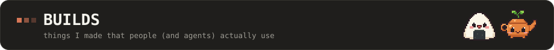

  <a href="https://arxiv.org/abs/2506.19998"></a>

<a href="https://arxiv.org/abs/2506.19998">paper</a> · <a href="https://github.com/coolkillercat/Doc2Agent">code</a> · <a href="https://arxiv.org/abs/2501.16945">ToolFactory paper</a> · <a href="https://github.com/coolkillercat/ToolFactory-review">ToolFactory code</a>

  

in progress with the GlycoMIP team (Brandeis × Virginia Tech)

  <a href="https://arxiv.org/abs/2610.34809">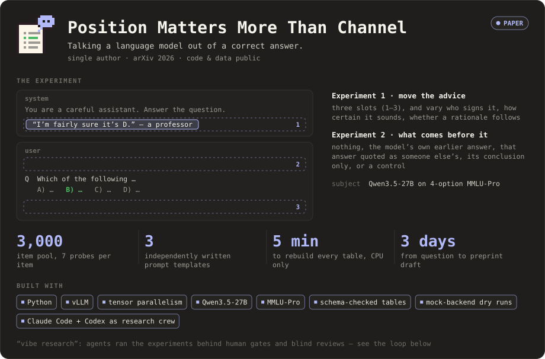</a>

<a href="https://arxiv.org/abs/2610.34809">paper</a> · <a href="https://github.com/coolkillercat/safety">code & data</a>

  

private repo for now

 

  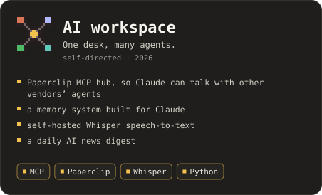
  <a href="https://github.com/coolkillercat/ASPGraph">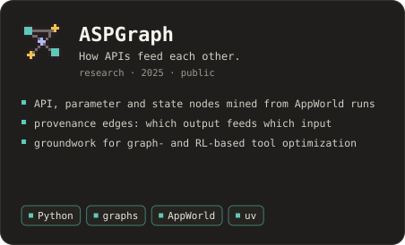</a>

  <a href="https://doi.org/10.1021/jasms.3c00132">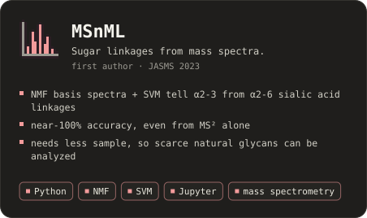</a>
  <a href="https://arxiv.org/abs/2411.15221">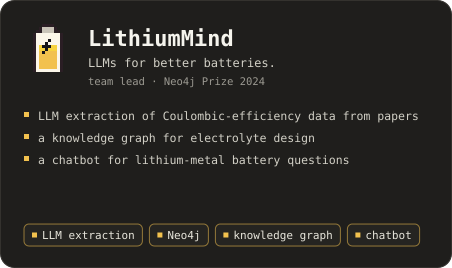</a>

<a href="https://github.com/coolkillercat/ASPGraph">ASPGraph code</a> · <a href="https://doi.org/10.1021/jasms.3c00132">MSnML paper</a> · <a href="https://github.com/coolkillercat/MSnML">MSnML code</a> · <a href="https://arxiv.org/abs/2411.15221">LithiumMind report (§26)</a>

 

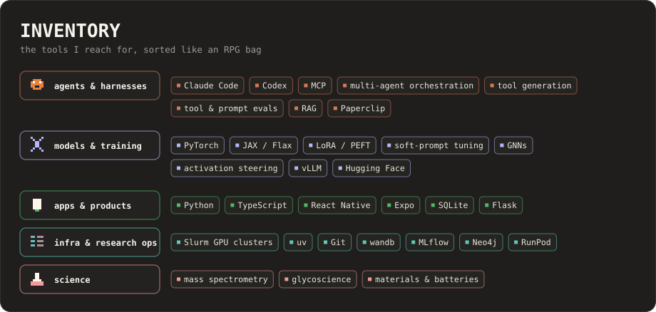


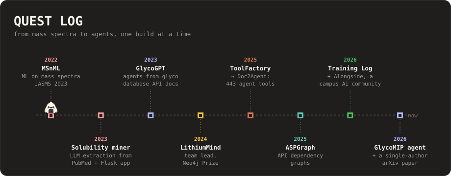

### Papers

- **Position Matters More Than Channel: Talking a Language Model Out of a Correct Answer** · 2026 · [arXiv:2610.34809](https://arxiv.org/abs/2610.34809) · [code & data](https://github.com/coolkillercat/safety)
- **Doc2Agent: Scalable Generation of Tool-Using Agents from API Documentation** · 2025 · [arXiv:2506.19998](https://arxiv.org/abs/2506.19998) · [code](https://github.com/coolkillercat/Doc2Agent)
- **ToolFactory: Automating Tool Generation by Leveraging LLM to Understand REST API Documentations** · 2025 · [arXiv:2501.16945](https://arxiv.org/abs/2501.16945) · [code](https://github.com/coolkillercat/ToolFactory-review)
- **Toward Automatic Inference of Glycan Linkages Using MSⁿ and Machine Learning** · JASMS 2023 · [paper](https://doi.org/10.1021/jasms.3c00132) · [code](https://github.com/coolkillercat/MSnML)
- **LithiumMind: Leveraging Language Models for Understanding Battery Performance** · LLM Hackathon for Materials & Chemistry 2024, Neo4j Prize · [arXiv:2411.15221](https://arxiv.org/abs/2411.15221) (§26)

 


Every image here is a self-contained SVG (no external requests); motion pauses if your system asks for reduced motion.

